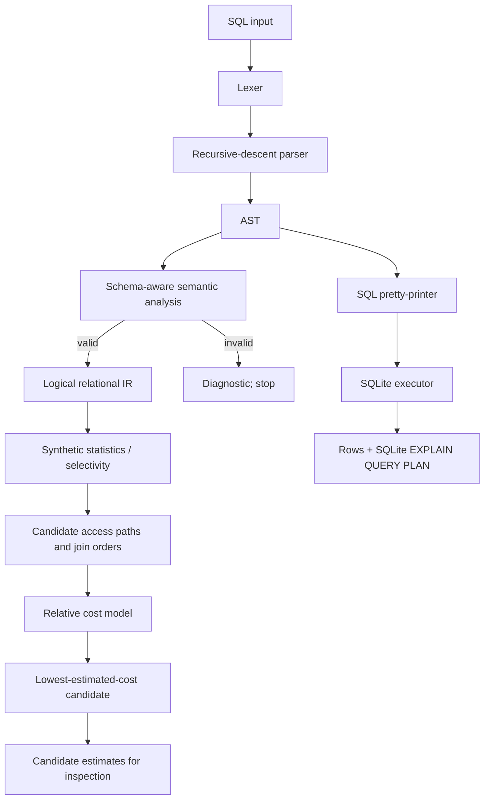

# COSTRA — All Project Documentation

Combined current documentation for the COSTRA Compiler Design project.


---

# Source document: `README.md`

# COSTRA - Cost-Based SQL Compiler & Query Optimizer

COSTRA is an educational Compiler Design project that makes the path from SQL text to a validated query representation and cost-estimated plan visible. It uses Python for the compiler/optimizer prototype and SQLite as a separate execution engine over a small deterministic sample database.

> **Important implementation boundary:** COSTRA estimates and compares candidate plans using synthetic statistics and a relative cost model. The selected COSTRA plan is shown for analysis; SQLite independently plans and executes the normalized SQL. COSTRA does not inject its selected physical plan into SQLite.

## Quick start

Requirements: Python 3.9 or newer. The project uses only the Python standard library.

Run the complete review demonstration without navigating the menu:

```bash
python3 main.py --demo
```

Other useful commands:

```bash
python3 main.py                 # interactive menu
python3 main.py --error-demo    # expected semantic rejection before execution
python3 main.py --query "SELECT name FROM Employee WHERE salary > 80000 LIMIT 2;"
```

Interactive switch-style menu options (`python3 main.py`):

1. **Review 1** — problem definition, objectives, scope, and system design.
2. **Review 2** — lexer, parser/AST, semantic checks, relational IR, and sample execution.
3. **Review 3** — complete multi-join pipeline, candidate plans, costs, SQLite output, EXPLAIN plan, and timings.
4. **Custom SQL** — enter one supported `SELECT` on the `SQL>` prompt.
5. **Cost calculation** — see a worked full-scan vs. index-scan formula, all six demo plan costs, and the minimum-cost candidate.
6. **Review-wise progress** — compare Review 1 → Review 2 → Review 3.
7. **Semantic error demo** — show unknown-column rejection before execution.
8. Exit.

Direct mode flags are also available: `--review1-demo`, `--review2-demo`, `--progress-demo`, `--cost-demo`, `--demo`, `--error-demo`, and `--query "SELECT ..."`.

Run the regression tests:

```bash
python3 -m unittest -v
```

Run the same commands used for the presentation:

```bash
./run_review3_demo.sh
./run_review3_error_demo.sh
```

Run the repeatable local benchmark:

```bash
python3 benchmark.py
```

The benchmark writes `reports/benchmark_results.json` and `reports/benchmark_results.csv`. The results are machine-local measurements and should not be interpreted as general performance guarantees.

## Processing pipeline

```text
SQL input
  -> Lexer / token stream
  -> Recursive-descent parser
  -> Abstract Syntax Tree (AST)
  -> Schema-aware semantic validation
  -> Logical relational IR
  -> Synthetic cardinality/selectivity estimation
  -> Candidate join-order and access-path generation
  -> Relative cost calculation and minimum-cost candidate selection
  -> Normalized SQL passed to SQLite
  -> Result rows + SQLite EXPLAIN QUERY PLAN + stage timings
```

## Current SQL subset

The parser supports a documented subset of `SELECT`:

- Projection expressions, aliases, `*`, qualified `table.*`, and `DISTINCT`.
- `FROM` with table names and aliases.
- `INNER JOIN`, `LEFT JOIN`, `RIGHT JOIN`, and `CROSS JOIN`.
- `WHERE` with parentheses, `NOT`, `AND`, `OR`, comparisons, arithmetic, `IS [NOT] NULL`, `[NOT] IN`, `[NOT] BETWEEN`, and `[NOT] LIKE`.
- `GROUP BY`, `HAVING`, `ORDER BY` with `ASC`/`DESC`, and non-negative integer `LIMIT`.
- `COUNT`, `SUM`, `AVG`, `MIN`, and `MAX`, including `COUNT(DISTINCT column)`.
- Integer, decimal/scientific-notation and quoted string literals, `NULL`, `TRUE`, `FALSE`, and `--` line comments.

This is not a full SQL implementation. Features such as subqueries, CTEs, window functions, `UNION`, quoted identifiers, `CASE`, `IS DISTINCT FROM`, and multi-statement scripts are outside the current scope.

## Modules

| File | Responsibility |
|---|---|
| `lexer.py` | Converts SQL characters into location-aware tokens and reports illegal characters. |
| `parser.py` | Recursive-descent parser with expression precedence and syntax diagnostics. |
| `ast_nodes.py` | AST dataclasses and safe formatting of supported expressions/queries. |
| `semantic.py` | Validates tables, aliases, columns, ambiguity, aggregate placement and basic grouping rules. |
| `schema.py` | Logical schema, synthetic row/distinct/range statistics, and modelled indexes. |
| `statistics.py` | Selectivity estimates for common predicates. |
| `ir.py` | Logical relational plan nodes and tree formatting. |
| `optimizer.py` | Access-path estimates, join-order alternatives, join-method costing, and selected candidate. |
| `compiler.py` | Runs lexer, parser, semantics and optimizer in order and captures stage timings/errors. |
| `executor.py` | Creates the in-memory SQLite fixture, executes normalized `SELECT` SQL, and returns SQLite's own query plan. |
| `main.py` | Interactive demonstration and readable pipeline output. |
| `test_costra.py` | Automated unit and integration regression tests. |
| `benchmark.py` | Repeatable local end-to-end timing runs with JSON/CSV output. |
| `docs/` | Final report, user guide, test plan, limitations, architecture and completion checklist. |

## How the optimizer works

1. Split simple `AND`-connected predicates and identify predicates that reference one table only.
2. Estimate filtered rows using hard-coded synthetic row counts, distinct counts, and numeric ranges.
3. Compare a table-scan estimate with an index-path estimate when a suitable modelled index and a simple searchable predicate are present.
4. For inner joins, enumerate candidate relation orders up to a configured cap. For each join step, estimate output cardinality and compare nested-loop, hash-join, and merge-join relative costs.
5. Preserve the written order when an outer or cross join makes arbitrary join reordering unsafe.
6. Add estimated aggregation, `HAVING`, distinct, sorting, limit and projection costs; return the six lowest-cost unique join-order candidates.

The cost numbers are **relative model units**, not milliseconds. The row counts and column distributions are synthetic. SQLite's `EXPLAIN QUERY PLAN` output is displayed separately as the plan SQLite actually selected for execution.

## Data used for the demo

The optimizer uses the synthetic statistics in `schema.py` (for example, 10,000 estimated employee rows and 30,000 assignment rows). The executor seeds a much smaller in-memory SQLite database with sample records so the demonstration stays fast and outputs are repeatable. Therefore, estimated cardinalities are not expected to match the sample execution row counts.

## Quality checks

- Test suite: `python3 -m unittest -v` (52 tests in the latest checked run)
- Test case inventory and latest observed results: `docs/TEST_PLAN.md` and `reports/test_results.txt`
- Final project report (source): `docs/FINAL_PROJECT_REPORT.md`
- Final project report (PDF): [reports/COSTRA_Final_Project_Report.pdf](reports/COSTRA_Final_Project_Report.pdf)
- Final review presentation (editable PowerPoint): [presentation/COSTRA_Final_Project_Review3_Demonstration.pptx](presentation/COSTRA_Final_Project_Review3_Demonstration.pptx)
- Final review presentation (PDF): [presentation/COSTRA_Final_Project_Review3_Demonstration.pdf](presentation/COSTRA_Final_Project_Review3_Demonstration.pdf)
- Step-by-step run instructions: `docs/USER_GUIDE.md`
- Personal screenshot capture requests: `docs/SCREENSHOTS_NEEDED.md`
- Review 3 demonstration script: `docs/DEMO_SCRIPT.md`
- Final-review checklist: `docs/REVIEW_3_CHECKLIST.md`
- Planned work from Review 2 to final review: `docs/PHASE3_COMPLETION_PLAN.md`

## Current limitations and responsible claims

- Candidate costs and cardinalities use an educational heuristic model, not live database statistics.
- Candidate plan output is analytical; it is not forced into SQLite's physical execution engine.
- Join-order enumeration is exhaustive only within the configured cap, not a dynamic-programming optimizer.
- The sample database is intentionally small and is not a production benchmark dataset.
- Type checking and SQL semantics cover the documented subset, not the full SQL standard.

These limitations are explicit so the implementation can be explained accurately during the final review.


---

# Source document: `docs/ARCHITECTURE.md`

# COSTRA Architecture



The logical route and executable route share the validated AST, but the optimizer's chosen physical-plan estimate is **not** an input to SQLite. SQLite parses and plans the normalized SQL independently. This separation is intentional and must be explained during demonstration.

## Module responsibilities

- Lexical and syntax stages convert text to structured query data.
- Semantic analysis rejects references and aggregate usage that violate the supported schema/rules.
- The logical IR represents operations such as scan, join, filter, aggregate, having, distinct, sort, limit and projection.
- The cost model estimates alternative access paths and join orders using synthetic statistics.
- The executor uses SQLite for reproducible output and displays SQLite's own plan separately.


---

# Source document: `docs/USER_GUIDE.md`

# COSTRA User Guide

## 1. Requirements

- Python 3.9 or newer.
- No external Python packages are required for runtime.
- Open the project root in VS Code or use a terminal.

## 2. Start the professor-selectable menu

Run:

```bash
python3 main.py
```

The program presents an interactive, switch-style menu. Enter the number for the part your professor asks to see; after the selected walkthrough, COSTRA returns to the menu.

1. **Review 1 — Problem definition & design:** problem statement, objectives, supported SQL scope and designed pipeline.
2. **Review 2 — Core implementation:** lexer, syntax/AST, semantic checks, relational IR and a representative sample query.
3. **Review 3 — Full end-to-end demo:** full multi-join SQL query, token stream, AST, semantic checks, logical IR, six candidate costs, selected estimated plan, SQLite output, SQLite EXPLAIN plan and stage timings.
4. **Enter my own SELECT query:** type one supported SQL statement on one line at the `SQL>` prompt and end with a semicolon.
5. **Cost calculation & best plan:** calculates an example access-path estimate, prints all six multi-join candidate costs, and identifies the lowest estimated cost.
6. **Review-wise progress:** describes what Review 1, Review 2 and Review 3 demonstrate.
7. **Semantic error demonstration:** rejects an unknown column during semantic analysis before SQLite execution.
8. Exit.

## 3. Custom SQL example

Choose option 4 and enter this one-line query:

```sql
SELECT name, salary FROM Employee WHERE salary > 80000;
```

For a longer example, run the full demo (option 3) or use a direct CLI command. The parser supports the SQL subset documented in `README.md`; it is not a full SQL implementation.

## 4. Direct commands

Use a direct command when you want one walkthrough without opening the menu:

```bash
python3 main.py --review1-demo
python3 main.py --review2-demo
python3 main.py --progress-demo
python3 main.py --cost-demo
python3 main.py --demo
python3 main.py --error-demo
python3 main.py --query "SELECT name FROM Employee LIMIT 2;"
```

## 5. How to explain cost output

- `estimated rows` are calculated from synthetic row counts, distinct counts, ranges and selectivity assumptions.
- `estimated cost` is a relative model quantity; it is **not milliseconds**.
- COSTRA compares access paths and join-method estimates, generates candidate join orders, and selects the lowest-cost candidate among those generated.
- The full demo has six candidates. Plans 1 and 2 tie at **115,222.63 model units**; the implementation returns the first candidate at the minimum cost.
- SQLite independently plans and executes the normalized SQL. COSTRA does not inject its chosen physical tree into SQLite.

## 6. Run tests and benchmark

```bash
python3 -m unittest -v
python3 benchmark.py
```

The current regression suite contains 52 tests. The benchmark is a local timing tool over a tiny seeded in-memory SQLite fixture and should not be presented as proof that COSTRA is faster than SQLite.

## 7. Error handling

COSTRA stops when lexical, syntax or semantic validation fails. Example errors include an illegal character, invalid SQL syntax, unknown table, unknown alias, unknown column, ambiguous unqualified column, unsupported function or invalid grouping. A query that fails these stages is not executed.


---

# Source document: `docs/DEMO_SCRIPT.md`

# COSTRA Review 3 Demo Script

**Target duration:** about 5–7 minutes. Keep the terminal open at the project root.

## 1. Start at the menu

```bash
python3 main.py
```

COSTRA displays eight options. You can choose the walkthrough that matches the professor's question and then return to the menu without restarting.

## 2. Recommended route through the demo

1. **Option 6 — Review-wise progress.** Explain: Review 1 defined the problem and design; Review 2 demonstrated the core compiler modules; Review 3 integrates the pipeline, cost calculation, execution, error handling, testing and final documentation.
2. **Option 1 — Review 1 design.** Summarize the problem statement, objectives, supported SQL scope and designed architecture.
3. **Option 2 — Review 2 core modules.** Show tokens, AST, semantic validation, relational IR and a small sample query result.
4. **Option 4 — Own SQL input.** Enter `SELECT name, salary FROM Employee WHERE salary > 80000;` on one line after `SQL>`.
5. **Option 5 — Cost calculation.** Show the access-path formula, full scan vs. index estimate, six candidate plan costs and the minimum-cost selection.
6. **Option 3 — Review 3 complete demo.** Show the complex multi-join SQL, all compiler stages, the selected estimate, the three SQLite result rows, SQLite's separate `EXPLAIN QUERY PLAN`, and observed timings.
7. **Option 7 — Error handling.** Show an unknown-column reference being rejected before execution.
8. Run tests in a separate command to prove validation:

```bash
python3 -m unittest -v
```

## 3. One-line explanation of each stage

- **Lexer:** characters become tokens.
- **Parser/AST:** tokens are checked against the SQL grammar and represented as a syntax tree.
- **Semantic analysis:** tables, aliases, columns and supported aggregate/grouping rules are validated.
- **Relational IR:** the query is represented as logical scan, join, filter, aggregate, sort and projection operators.
- **Cost estimation:** synthetic statistics estimate rows and relative costs for candidate access paths, join methods and join orders.
- **Selection:** the candidate with the lowest estimated total is selected; Plans 1 and 2 tie at 115,222.63 model units for the full demo.
- **SQLite execution:** the normalized SQL is passed to SQLite, which independently chooses its real plan and returns rows.

## 4. Cost explanation to say aloud

“COSTRA estimates the work of access paths and join algorithms using estimated row counts. It compares candidate plans and chooses the minimum estimated total from the candidates it generated. These cost values are model units, not milliseconds, and SQLite independently chooses the actual execution plan.”

For the Employee salary-filter example: with 10,000 estimated input rows and 7,200 estimated output rows, full scan plus predicate costs `10,000 + 0.20 × 10,000 = 12,000.00`. The index estimate costs `2 × log2(10,000) + 0.60 × 7,200 = 4,346.58`. Under the model, the index path is lower-cost.

## 5. Short fallback commands

```bash
python3 main.py --review1-demo
python3 main.py --review2-demo
python3 main.py --progress-demo
python3 main.py --cost-demo
python3 main.py --demo
python3 main.py --error-demo
python3 -m unittest -v
```

## 6. Do not overclaim

COSTRA uses synthetic statistics and a simplified relative cost model. Its chosen estimated plan is not injected into SQLite. Explain that boundary openly if asked.


---

# Source document: `docs/TEST_PLAN.md`

# COSTRA Test Plan and Results

## Test approach

COSTRA uses Python's standard-library `unittest` so the suite can run on a clean Python installation without adding dependencies. Test groups cover the lexer, parser, semantic validation, estimated optimization, and SQLite-backed end-to-end execution.

| Area | Covered behavior |
|---|---|
| Lexer | Token classes, case-insensitive keywords, line/column locations, comments, escaped quotes, unexpected characters |
| Parser | SELECT clauses, joins, aliases, AST shape, operator precedence, arithmetic, aggregate calls, DISTINCT, NULL/IN/BETWEEN/LIKE, invalid LIMIT and malformed statements |
| Semantics | Unknown table/alias/column, duplicate aliases, ambiguous columns, invalid aggregate placement, unsupported functions, type and GROUP BY checks, ORDER BY output aliases |
| Optimizer | Minimum-cost selection, multiple inner-join orders, index-path estimate, scalar aggregation, DISTINCT node, outer-join order preservation |
| Execution | Deterministic demo results, literal handling, LEFT JOIN, SQLite EXPLAIN output, lexical/syntax/semantic fail-fast behavior |

## Expected positive checks

- The demo query completes and returns rows with `department`, `employee_count` and `average_salary` columns.
- A simple salary filter returns a sorted result from SQLite.
- `COUNT(*)`, grouping, `DISTINCT`, `IN`, `BETWEEN`, `LIKE` and `IS NULL` statements are parsed and validated where they match the supported subset.
- COSTRA returns the minimum cost among candidates generated for a given query.

## Expected negative checks

- Lexical errors include line and column.
- Syntax errors name the unexpected token or expected grammar item.
- Semantic errors include unknown table/alias/column, ambiguous unqualified columns, aggregate usage in `WHERE`, unsupported function names, incompatible `SUM`/`AVG` input types, and invalid grouped projections.
- The pipeline does not execute statements that fail lexical, syntax or semantic validation.

## Latest recorded result

Regenerate with `python3 -m unittest -v` from the repository root. The shipped test output is saved in `reports/test_results.txt`. The latest verified run on 20 October 2026 reports **52 tests passed**; the exact output is stored in `reports/test_results.txt`.

## Interpretation limits

The sample database is small; the synthetic optimizer statistics are intentionally not calibrated against it. Test success validates supported examples and error paths, not compliance with the entire SQL language standard. Runtime benchmarks are local evidence only.


---

# Source document: `docs/FINAL_PROJECT_REPORT.md`

# COSTRA - Cost-Based SQL Compiler & Query Optimizer

**Compiler Design Laboratory - Final Implementation and Testing Report**  
**Student:** Arsh Shukla  
**Registration No.:** 24BDS0113  
**Institution:** VIT Vellore  
**Project type:** Individual project  
**Implementation language:** Python  
**Execution backend:** SQLite

---

## Abstract

COSTRA is an educational SQL compiler and query-optimization prototype. It accepts a supported subset of SQL `SELECT` statements and displays the main language-processing stages: lexical analysis, recursive-descent parsing, abstract syntax tree construction, schema-aware semantic checks, logical relational representation, heuristic cardinality estimation, candidate join-order generation and relative cost-based plan selection. Validated SQL is normalized and executed by an in-memory SQLite database so that results can be inspected during a demonstration.

The implementation deliberately separates COSTRA's estimated physical plan from SQLite's own execution plan. COSTRA uses synthetic row counts, distinct counts, ranges and modelled indexes to compare alternatives. SQLite then independently plans and executes the normalized SQL. This makes the project useful for explaining compiler stages and query-optimization reasoning without claiming to replace a production database optimizer.

The final code includes a command-line demo, a deterministic fixture database, a regression test suite and a repeatable benchmark script. At the report build, 52 automated tests pass. Four representative queries were benchmarked over 30 measured runs each after three warm-up runs; results were repeatable in the local development environment. The numbers are recorded as local evidence rather than general performance guarantees.

## Chapter 1 - Introduction

A database query is written declaratively: the query states what result is required, not every low-level step that must be executed to obtain it. A database engine must parse the query, validate table and column references, construct a logical representation and choose an execution strategy. Join order and access paths matter because the amount of intermediate data can change substantially depending on those choices.

COSTRA brings these ideas into a small Compiler Design project. The SQL statement acts as the source language. The lexer produces tokens, the parser builds an AST, semantic analysis checks references against a known schema, and a relational intermediate representation records operators such as scans, joins, filters, aggregation and sorting. A simplified cost model then compares candidate plans. Finally, SQLite executes the normalized SQL so that the user can compare estimated planning output with real returned rows and SQLite's separately selected query plan.

The scope is intentionally limited. The program is a teaching prototype for the documented query subset, not a complete SQL parser or a production query optimizer.

## Chapter 2 - Problem Statement and Motivation

### Problem statement

A SQL query can have multiple plausible execution strategies. Without a visible representation, the stages between the original query text and the final rows are difficult for a student to inspect. COSTRA addresses this learning problem by making tokenization, parsing, semantic checks, relational operators and relative plan costs visible in one run.

### Motivation

The project connects multiple topics taught in Compiler Design and database systems: lexical rules, grammar and precedence, ASTs, semantic validation, intermediate representations, cardinality, access paths, join algorithms and the separation between logical and physical plans. The command-line workflow keeps the example small enough to explain during a live review.

### Objectives

1. Implement a tokenizer with useful source locations and lexical errors.
2. Parse a practical subset of SQL `SELECT` into an AST.
3. Detect common semantic errors using a schema and table aliases.
4. Build a readable logical relational plan.
5. Estimate cardinalities and relative costs using synthetic statistics.
6. Compare candidate join orders and join methods, then select the lowest estimated cost among those generated.
7. Execute valid examples with SQLite and display output, SQLite's own plan and observed stage timings.
8. Deliver repeatable tests, a benchmark tool, documentation and clear usage instructions.

## Chapter 3 - Background Study

### Lexical and syntax analysis

Lexical analysis groups source characters into tokens such as keywords, identifiers, numeric literals, strings, operators and punctuation. Syntax analysis checks whether the token stream follows a grammar. COSTRA uses a recursive-descent parser with layered expression functions to implement precedence: logical `OR`, logical `AND`, `NOT`, comparisons, additive operations, multiplicative operations, unary operators and primary expressions.

### AST and semantic validation

An abstract syntax tree represents the meaning-bearing structure of a query rather than retaining only the original text. Semantic analysis checks whether tables exist in the configured schema, whether aliases resolve, whether referenced columns exist, whether unqualified columns are ambiguous, and whether aggregates are used in supported clauses and grouping combinations.

### Relational representation

The relational intermediate representation uses nodes for table scans, joins, filters, aggregation, `HAVING`, `DISTINCT`, sorting, limiting and projection. Separating this representation from the textual SQL allows the project to show how a query's logical operations are arranged before discussing physical methods.

### Query optimization

A cost-based optimizer estimates the work associated with candidate strategies and chooses the lowest estimated cost from the candidates it generated. Real database systems use sophisticated statistics, constraints, histograms, search strategies and calibrated cost models. COSTRA intentionally uses synthetic statistics and a compact heuristic cost model so the calculations stay inspectable.

## Chapter 4 - Scope and Requirements

### Supported scope

The parser supports projection expressions, aliases, `*`, qualified `table.*`, `DISTINCT`, table aliases, inner/left/right/cross joins, `WHERE`, `GROUP BY`, `HAVING`, `ORDER BY`, integer `LIMIT`, five aggregate functions, arithmetic, comparisons, Boolean operators, `IS [NOT] NULL`, `[NOT] IN`, `[NOT] BETWEEN`, `[NOT] LIKE`, numeric/string/NULL/Boolean literals and line comments.

### Out of scope

Subqueries, common table expressions, window functions, `UNION`, `CASE`, quoted identifiers, full SQL type inference, multi-statement scripts and complete SQL-standard compliance are not implemented. The README lists the same boundary for users.

### Functional requirements

- Process one supported `SELECT` statement.
- Report lexical, syntax and semantic errors without proceeding to execution when a prior stage fails.
- Represent the parsed query in an AST and logical IR.
- Estimate rows/costs and retain a small set of candidate plans.
- Execute valid normalized SQL and show its output.
- Make the estimated COSTRA plan and SQLite's actual plan visibly distinct.
- Provide tests and instructions that run without third-party Python packages.

## Chapter 5 - System Design

### Pipeline


*Figure 1. The analytical optimizer branch and SQLite execution branch are kept separate.*

The two branches meet only through the query representation: COSTRA displays its own estimated plan, while SQLite independently plans and executes the normalized SQL. No code passes COSTRA's chosen join order or physical operator tree into SQLite's internal query planner.

### Module map

| Module | Role in the design |
|---|---|
| `lexer.py` | Token recognition, keyword normalization and location-aware lexical diagnostics |
| `parser.py` | Recursive-descent grammar and expression precedence |
| `ast_nodes.py` | AST data structures and normalized SQL formatting |
| `semantic.py` | Schema, alias, column, aggregate and grouping checks |
| `schema.py` | Schema declarations, synthetic planning statistics and modelled indexes |
| `statistics.py` | Predicate selectivity and referenced-column helpers |
| `ir.py` | Logical relational plan node construction and tree output |
| `optimizer.py` | Scan/access-path estimates, join-order enumeration, join costing, aggregate/sort costs and selection |
| `compiler.py` | Orchestrates compile and optimize stages, capturing errors/timings |
| `executor.py` | Seeds the in-memory SQLite fixture, executes normalized SQL and exposes SQLite's own plan |
| `main.py` | Interactive end-to-end demonstration and readable console output |
| `test_costra.py` | Unit and integration regression tests |
| `benchmark.py` | Repeatable local end-to-end timing with JSON/CSV results |

## Chapter 6 - Compiler Design Concepts Used

### Lexical analysis

The tokenizer distinguishes keywords, identifiers, numbers, strings, operators, punctuation and comments. It records line and column locations, so invalid characters can be reported without displaying an unhelpful traceback.

### Syntax analysis and AST

The recursive-descent parser separates expression precedence into functions. Parentheses override normal precedence. The AST uses dataclasses such as `SelectQuery`, `SelectItem`, `TableRef`, `JoinClause`, `ColumnRef`, `Literal`, `BinaryExpr`, `FunctionCall` and predicate nodes for `IN`, `BETWEEN` and `IS NULL`.

### Semantic analysis and symbol/alias resolution

The analyzer maps each table reference or alias to a canonical schema table. It checks unknown or duplicated aliases, invalid table references, missing columns, ambiguous unqualified columns and unsupported function/aggregate use. Basic grouping checks prevent common invalid selections that mix aggregate and ungrouped columns.

### Intermediate representation

The logical plan is represented as a tree of relational operators. This is an intermediate representation because it is a structured query plan rather than the original string or an executed result.

### Optimization

The optimizer computes simple selectivity estimates for common predicates, uses modelled index availability to compare access-path costs, and enumerates candidate relation orders for eligible inner joins. At each join step it compares nested-loop, hash-join and merge-join estimates. If an outer or cross join is present, it preserves the written join order rather than freely commuting the relation order.

## Chapter 7 - Implementation Details

### Statistics and access-path estimates

The `STATS` dictionary includes synthetic row counts, distinct counts and numeric ranges. `INDEXES` lists indexes assumed by the model. These values are used only for the optimizer's educational estimate. They are neither queried from SQLite nor continuously updated from data.

For a table with a simple searchable predicate on a modelled indexed column, the estimate compares a full scan with an index-path estimate. The lower-cost access path is shown in the selected estimated plan. This is a model choice, not a command to create or use that index in SQLite.

### Join-order and join-method comparison

COSTRA generates inner-join relation permutations up to a safety cap, attaches join predicates when their referenced relations are available, estimates output cardinalities, and chooses a join algorithm for each join step according to the relative cost formulas. It retains up to six low-cost join-order candidates. This is capped permutation enumeration with a greedy per-step algorithm choice; it is not a dynamic-programming optimizer.

### Execution

The executor creates a fresh in-memory SQLite database with four tables: `Employee`, `Department`, `Project` and `Assignment`. The fixture is deliberately small and deterministic. After successful lexical, syntax and semantic checks, the AST is formatted as one SQL `SELECT` and passed to SQLite. The program displays returned headers/rows and calls `EXPLAIN QUERY PLAN` separately.

### Error behavior

The compile pipeline returns a failed stage and diagnostic for lexical, syntax, semantic or optimizer errors. Queries that fail the first three validation stages are not executed. SQLite exceptions are wrapped in a readable `ExecutionError`.

### Professor-selectable review menu

The default `python3 main.py` command opens an eight-option interactive menu. Options 1-3 present Review 1 design, Review 2 core-module walkthrough, and Review 3 end-to-end execution; option 4 accepts one user-entered `SELECT`; option 5 prints a worked access-path calculation and compares the six multi-join candidates; option 6 summarizes the review milestones; option 7 demonstrates semantic rejection; and option 8 exits. Each option returns to the menu so the presenter can choose the next demonstration in response to a question. The menu is switch-style dispatch implemented with a dictionary so it remains compatible with Python 3.9+.

## Chapter 8 - Testing and Validation

The project includes 52 regression tests in the current checked-in suite. They cover:

- Token classes, keyword casing, comments, escaped strings, and location-aware lexical errors.
- Clause parsing, precedence, qualified wildcard selection, aggregate syntax, predicate extensions and invalid statement shapes.
- Unknown/duplicate aliases, unknown tables/columns, ambiguous columns, aggregate placement, unsupported functions, type checks and grouping rules.
- Candidate generation, cost-minimum selection, indexed access-path estimates, scalar aggregation, `DISTINCT` and outer-join order preservation.
- Repeatable demo output, SQLite's actual query plan, string handling, inner/outer/cross join execution, and fail-fast behavior.

### Test result

The regression run recorded in `reports/test_results.txt` is **52 tests passed**. Tests are implemented with the Python standard library and can be repeated with `python3 -m unittest -v`.

## Chapter 9 - Results and Performance Evidence

### Functional demo

The example query joins employee, department, assignment and project data, filters on employee salary and project budget, groups by department, applies an aggregate `HAVING`, sorts by average salary and applies `LIMIT 5`. In the small seeded fixture, it returns the following rows:

| Department | Employee count | Average salary |
|---|---:|---:|
| Finance | 1 | 91000.0 |
| Engineering | 5 | 79600.0 |
| HR | 1 | 69000.0 |

Only three rows meet the query's conditions in the seeded sample. The project does not infer that the synthetic planning statistics should predict the same result count; its planning estimates model a larger hypothetical dataset.

### Local benchmark

Four queries were measured with three warm-up runs and 30 measured repetitions using one reused in-memory SQLite fixture. The end-to-end clock covers COSTRA compile/optimization and the executor call. The values below are local observations from the recorded environment, not service-level guarantees.

| Query | Rows | Candidate plans | Median end-to-end time |
|---|---:|---:|---:|
| Multi-join aggregation demo | 3 | 6 | 1.7283 ms |
| Indexed salary filter | 2 | 1 | 0.1520 ms |
| Grouped department counts | 4 | 2 | 0.2551 ms |
| Distinct departments | 4 | 1 | 0.0837 ms |

Full min/median/mean/p95/max and stage medians are available in `reports/benchmark_results.json`; the summary is in `reports/benchmark_results.csv`. The runtime environment metadata is stored alongside the results.

### Interpretation

The results confirm that the examples execute consistently in this environment and give a repeatable demonstration of the pipeline. They do not prove that COSTRA is faster than SQLite: SQLite still chooses its own execution plan, and the SQL queries run over eight employee fixture rows. The synthetic cost units should not be compared directly to the measured milliseconds.

## Chapter 10 - Limitations and Future Enhancements

### Current limitations

1. The parser implements a SQL subset, not the complete SQL grammar.
2. Statistics and selectivity are synthetic and can differ greatly from sample data.
3. Join-order enumeration uses capped permutations rather than dynamic programming.
4. The optimizer's selected estimated plan is not injected into SQLite's execution engine.
5. The fixture is small and in memory; it does not represent production workloads.
6. Stage timings vary with hardware, Python version and machine load.

### Possible future work

- Replace hard-coded statistics with collected table/column statistics and histograms.
- Use a dynamic-programming join-order search or a memoized search space for larger queries.
- Add stronger expression type checking and broader grouping/aggregate rules.
- Add `CASE`, subqueries, CTEs, `UNION`, and window functions after defining and testing the expanded grammar.
- Add optional AST/IR tree visualization to help explain the intermediate representations.
- If true plan execution is desired, implement a small executor that follows COSTRA's physical operators directly rather than suggesting that SQLite honors its plan.
- Increase dataset scale and conduct controlled repeated performance experiments with documented machine details.

## Chapter 11 - Conclusion

COSTRA demonstrates a coherent SQL-processing pipeline suitable for explaining Compiler Design concepts in an executable form. It turns SQL text into tokens, an AST, semantic diagnostics and relational IR; it then uses synthetic statistics to compare access paths and inner-join orders before displaying the cheapest estimated candidate. Valid queries are executed by SQLite and accompanied by SQLite's own plan and timing evidence.

The final implementation adds broader predicate parsing, stronger semantic checks, fail-fast diagnostics, outer-join order protection, candidate-plan detail, automated regression coverage, a repeatable benchmark and final-review documentation. Its strongest result is not a claim to replace a commercial optimizer; it is a transparent, testable learning tool with a clearly stated execution boundary.

## References

1. A. V. Aho, M. S. Lam, R. Sethi and J. D. Ullman, *Compilers: Principles, Techniques, and Tools*, 2nd ed., Pearson, 2006.
2. SQLite documentation, “EXPLAIN QUERY PLAN.” https://sqlite.org/eqp.html
3. SQLite documentation, “SELECT.” https://sqlite.org/lang_select.html
4. Python documentation, `sqlite3` — DB-API 2.0 interface for SQLite databases. https://docs.python.org/3/library/sqlite3.html
5. COSTRA source modules, tests and benchmark artifacts in this repository.

## Appendix A - Run commands

```bash
python3 main.py --demo
python3 main.py --error-demo
python3 -m unittest -v
python3 benchmark.py
```

## Appendix B - Demonstration checklist

1. Show the repository files and run `python3 main.py`.
2. Run the complete multi-join demo.
3. Explain tokenization, AST construction and semantic validation.
4. Point to the logical relational plan.
5. Compare the candidate costs and explain the selected estimate.
6. Show the result rows and SQLite's independent `EXPLAIN QUERY PLAN` output.
7. Run the unknown-column example to demonstrate semantic error handling.
8. Mention the key boundary: COSTRA estimates plans; SQLite independently executes the normalized SQL.


---

# Source document: `docs/REVIEW3_PRESENTER_GUIDE.md`

# COSTRA — Review 3 Presenter Guide

**Target duration:** 8–10 minutes plus questions.  
**Presentation:** `presentation/COSTRA_Final_Project_Review3_Demonstration.pptx`  
**Student:** Arsh Shukla · 24BDS0113 · VIT Vellore

## Before the review

1. Open the extracted project folder in VS Code.
2. In the terminal, run `python3 --version` and confirm Python 3.9 or newer.
3. Run `python3 -m unittest -v`. The current checked suite has 52 tests and should end with `OK`.
4. Run `python3 main.py` to open the professor-selectable menu.
5. Run `python3 main.py --demo` once if you want the complete output ready for reference.

## Professor-selectable demo menu

Run `python3 main.py`; choose the number matching the request. COSTRA returns to the menu after each option.

1. **Review 1 — design:** problem, objectives, scope and architecture.
2. **Review 2 — core implementation:** lexer, AST, semantic checks, relational IR and a sample query result.
3. **Review 3 — full demonstration:** full multi-join query, candidates, selected estimated plan, SQLite output, SQLite query plan and timings.
4. **Enter a custom SELECT:** type the complete SQL on one line at the `SQL>` prompt and finish with a semicolon.
5. **Cost calculation / best choice:** a worked index-vs-scan example, all six demo candidate costs, and the minimum-cost candidate(s).
6. **Review-wise progress:** summarizes Review 1 → Review 2 → Review 3.
7. **Semantic error demonstration:** unknown-column rejection before SQL execution.
8. Exit.

Direct commands, when you need one stage without showing the menu:

```bash
python3 main.py --review1-demo
python3 main.py --review2-demo
python3 main.py --progress-demo
python3 main.py --cost-demo
python3 main.py --demo
python3 main.py --error-demo
python3 main.py --query "SELECT name FROM Employee LIMIT 2;"
python3 -m unittest -v
```

## Slide-by-slide speaking notes (32 slides)

1. **Cover:** “COSTRA stands for Cost-Based SQL Compiler & Query Optimizer. This review shows the integrated system.”
2. **Overview:** “I’ll follow one SQL query through the major language and optimization stages.”
3. **Project progress:** “Review 1 defined the design, Review 2 demonstrated core modules, and the final phase integrates execution and validation.”
4. **Review milestones:** Explain the specific deliverables of Review 1, Review 2 and Review 3; these are project milestones and menu walkthroughs, not separate compilers.
5. **Motivation and scope:** “SQL is declarative. COSTRA makes the processing steps and plan reasoning visible for learning.”
6. **Worked query:** Point out the joins, filters, group by, HAVING, ORDER BY and LIMIT.
7. **Live input:** If asked to enter SQL, run `python3 main.py`, select option 4, and type a one-line SELECT.
8. **Compiler concepts:** “The project demonstrates lexer, parser/AST, semantic checks, relational IR and cost-based analysis. SQLite is the separate execution backend.”
9. **Architecture:** Walk through the pipeline and distinguish COSTRA’s analytical optimizer from SQLite execution.
10. **Lexer:** Tokens recognized include keywords, identifiers, operators, literals and punctuation; lexical errors stop the pipeline.
11. **Parser / AST:** The parser checks grammar and precedence, then creates a structured representation of the SQL.
12. **Semantic analysis:** Explain table, alias and column validation and why invalid references should not reach SQLite.
13. **Relational IR:** Explain logical operators such as scan, join, filter, aggregate, HAVING, sort, limit and project.
14. **Cardinality:** “Cardinality estimates the number of rows; selectivity estimates the fraction that passes a predicate. Values here are synthetic.”
15. **Plan alternatives:** The model compares access paths and nested-loop, hash and merge join costs; join enumeration has a cap.
16. **Candidate costs:** Plans 1 and 2 tie at 115,222.63 model units; plans 3–6 are higher.
17. **Cost formulas:** Explain full scan, index scan, nested-loop, hash, merge, aggregation, distinct, sort and projection terms.
18. **Worked cost example:** Employee `salary > 60000`: 10,000 estimated input rows; 7,200 estimated outputs; full scan plus predicate = 12,000.00; index estimate = 4,346.58, so the index path has the lower estimate.
19. **Selected plan:** The optimizer chooses a candidate with minimum estimated total cost. Plans 1 and 2 tie; the first minimum is returned by the current implementation.
20. **Technical boundary:** “SQLite does not execute the chosen COSTRA physical tree. It independently plans the normalized SQL.”
21. **Normalized SQL:** Show the validated AST rendered as normalized SQL sent to SQLite.
22. **Results:** The current seed fixture returns Finance, Engineering and HR; distinguish these three actual sample rows from synthetic estimated rows.
23. **SQLite query plan:** This is SQLite’s own `EXPLAIN QUERY PLAN` output, separate from COSTRA’s estimate.
24. **Timings:** Observed local stage timings in milliseconds; one run on a tiny in-memory fixture is evidence, not a general benchmark.
25. **Error handling:** Show an invalid column rejected at semantic analysis before execution.
26. **Tests:** “The checked regression suite passes 52 tests covering lexer, parser, semantics, optimizer and execution/CLI cases.”
27. **Source modules:** Explain the division of responsibilities across files.
28. **Interactive menu:** Show that the professor can select Review 1, Review 2, Review 3, custom input, cost formula, review progress or error handling without restarting VS Code.
29. **Recommended demo flow:** Run menu option 6, then 1, 2, 3, 4 and 5 as useful; show option 7 for error handling and then the test command.
30. **Limitations:** Synthetic statistics, bounded join-order search, SQL subset, and no selected-plan injection into SQLite.
31. **Viva preparation:** Use the questions below; answer directly and do not claim behavior beyond the code.
32. **Closing:** “Thank you. I’m ready to explain any module, formula, test or limitation.”

## What to say about cost and plan selection

COSTRA estimates the work of candidate access paths and join algorithms using estimated rows. It compares the candidates and selects the lowest estimated total under its own cost model. Cost values are **relative model units**, not milliseconds. SQLite independently chooses the actual execution plan for the normalized SQL.

Key formulas implemented in `optimizer.py`:

- Full scan: `N`
- Predicate evaluation: `0.20 × input_rows`
- Index scan: `2 × log2(max(2, N)) + 0.60 × output_rows`
- Nested-loop join: `0.15 × L × max(1, R)`
- Hash join: `1.10 × (L + R) + 0.25 × min(L, R)`
- Merge join: `0.80 × (L + R) + 0.45 × L × log2(max(2, L)) + 0.45 × R × log2(max(2, R))`

Worked access-path calculation for Employee (`N=10,000`, estimated output `7,200`):

- Full scan + predicate = `10,000 + 0.20 × 10,000 = 12,000.00`
- Index scan = `2 × log2(10,000) + 0.60 × 7,200 = 4,346.58`
- Therefore the estimated index path is lower in this example.

For the multi-join demo, the six costs are 115,222.63, 115,222.63, 121,702.63, 121,702.63, 123,862.63 and 123,862.63 model units. Plans 1 and 2 tie at the minimum. The implementation returns the first minimum candidate in its stable candidate list.

## Likely professor questions and short answers

**Why is this a Compiler Design project?** SQL is treated as a source language and passed through tokenization, parsing/AST, semantic validation and a relational IR before optimization analysis.

**What is cardinality?** The estimated row count for a relation or intermediate operator.

**What is selectivity?** The estimated fraction of rows that satisfy a predicate.

**Why use an AST?** It represents the structural meaning of the query so later stages do not need to interpret raw SQL text.

**Why use a relational IR?** It separates logical query operations from source syntax and makes the operator tree inspectable.

**What does the cost 115,222.63 mean?** It is a relative synthetic cost estimate, not wall-clock time.

**Why choose the lowest-cost plan?** Under the same model, it has the smallest estimated total work among the generated candidates; it is not a guarantee of the fastest real execution.

**Why do Plans 1 and 2 tie?** Their cost model totals are equal at the displayed precision. The current code selects the first candidate returned at the minimum.

**Does SQLite execute the plan selected by COSTRA?** No. SQLite plans and executes normalized SQL independently.

**Why are estimated rows different from returned rows?** Planning statistics describe a synthetic larger dataset; execution uses a tiny seeded fixture.

**What is the main limitation?** Synthetic statistics/costs, bounded join-order enumeration, a SQL subset, and no physical-plan injection into SQLite.

**What happens for an unknown column?** Semantic analysis rejects it and the program reports the failed stage without executing the SQL.

**How do you demonstrate your own input?** Run `python3 main.py`, select option 4, and enter one supported SELECT statement at `SQL>`.

## Test and screenshot checklist

- Run `python3 -m unittest -v`; current checked output reports 52 tests and `OK`.
- Capture a screenshot of the interactive menu.
- Capture a custom SQL input/output.
- Capture the six plan costs and the lowest-cost decision.
- Capture the 3 returned demo rows and SQLite’s separate plan.
- Capture the semantic-error demo and final test summary.


---

# Source document: `docs/REVIEW_3_CHECKLIST.md`

# Review 3 - Submission Checklist

## Working project
- [ ] Run `python3 main.py --demo` on the machine used for the review.
- [ ] Demonstrate the multi-join query end to end.
- [ ] Show valid and invalid input cases without a traceback.
- [ ] Explain lexer, parser/AST, semantic analysis, relational IR, optimizer, cost model and executor.
- [ ] Explain how synthetic estimates differ from measured time and SQLite's own plan.

## Code and quality
- [ ] `python3 -m unittest -v` passes from a clean checkout (52 tests in the latest checked run).
- [ ] `python3 benchmark.py` regenerates JSON and CSV.
- [ ] No secrets, virtual environments, bytecode caches or temporary exports in the repository.
- [ ] Main modules have clear responsibility and readable names.

## Evidence and documentation
- [ ] Test plan and test results match the latest source.
- [ ] Keep terminal/output screenshots that are genuine and captured from the current version.
- [ ] Final report covers all required chapters and limitations.
- [ ] User guide has exact setup and commands.
- [ ] Final presentation and report links open.

## Submission
- [ ] Confirm the official Review 3 date and slot from the faculty date sheet.
- [ ] Commit the final version to GitHub after reviewing the staged diff.
- [ ] Keep a clean local ZIP/backup of the submitted repository.


---

# Source document: `docs/PHASE3_COMPLETION_PLAN.md`

# COSTRA: Review 2 to Final Review Completion Plan

The official Compiler Design Lab instruction manual requires Phase 3 to complete remaining functionality, integrate all modules, test valid/invalid/boundary/error/complex inputs, provide meaningful errors, evaluate performance where applicable, and prepare the final report, presentation and user instructions.

The manual does not specify the student's exact scheduled review dates. These were proposed work targets beginning 14 October 2026, not official faculty deadlines. Recheck the faculty date sheet before treating any target as a submission deadline.

| Target | Work block | Definition of done |
|---|---|---|
| 14-15 Oct | Review 2 audit | Module inventory, baseline run, current issues and target test cases recorded. |
| 16-18 Oct | Integration and code hardening | Parser, semantics, IR, optimizer and executor work through the same end-to-end pipeline; useful errors; regression tests. |
| 19-20 Oct | Validation | Positive, negative, boundary and complex SQL tests pass and their outputs are saved. |
| 21 Oct | Evidence and performance | Test output, example results, SQLite's plan, and repeatable local end-to-end timing report saved with limits clearly described. |
| 22-23 Oct | Documentation | README, module descriptions, architecture, final report, test plan and user guide are ready. |
| 24-25 Oct | Final presentation and repository review | Demo order rehearsed, final presentation updated, repo cleaned, checklist completed. |
| On the official Review 3 date | Submission buffer | Confirm date/time against the actual date sheet, rerun tests on the demo machine, and submit all deliverables. |

## Required deliverables from the instruction manual

- Complete working project and complete source code
- Test cases and results
- Screenshots/output evidence
- Final project report
- Presentation
- User instructions

## Release gate

Do not label the project final until `python3 -m unittest -v` passes, `python3 main.py` completes its demo, the benchmark artifacts are regenerated from the current source, the final report matches the shipped code, and the Review 3 date is checked against the faculty date sheet.


---

# Source document: `docs/FINAL_RELEASE_NOTES.md`

# COSTRA Final Release Notes

**Release preparation date:** 15 October 2026

## Run commands

```bash
python3 -m compileall -q .
python3 main.py --demo
python3 main.py --error-demo
python3 -m unittest -v
python3 benchmark.py
```

## Current checked results

- `python3 -m compileall -q .`: passed.
- `python3 -m unittest -v`: 52 tests passed.
- `python3 main.py --demo`: completed and returned three rows.
- `python3 main.py --error-demo`: rejected an unknown column during semantic analysis before execution.
- `python3 benchmark.py`: regenerated JSON and CSV for four query shapes, with three warm-ups and 30 measured repetitions each.
- Review 3 presentation: 28 slides, centered on a worked SQL compilation example and real stage outputs.

## Important project boundary

The optimizer uses synthetic statistics and relative model-cost units. These are not elapsed milliseconds. SQLite independently plans and executes normalized SQL; COSTRA does not inject its chosen estimated plan into SQLite.

## Before submission

Run the commands again on the presentation machine. Confirm the official Review 3 schedule with faculty, capture current screenshots as described in `SCREENSHOTS_NEEDED.md`, and push the reviewed local changes to GitHub from an authenticated session.


---

# Source document: `docs/SCREENSHOTS_NEEDED.md`

# Screenshots to add to the Review 3 presentation

The current Review 3 deck uses clearly typeset excerpts from actual program output so every result is readable. To personalize it with genuine evidence from your Mac/VS Code, capture these screenshots from the same code version you will submit.

1. **VS Code project tree** — show the COSTRA folder and modules (`main.py`, `lexer.py`, `parser.py`, `semantic.py`, `ir.py`, `optimizer.py`, `executor.py`, `test_costra.py`). Keep any tokens, credentials or personal paths out of view.
2. **Demo: lexer, parser/AST, and semantic success** — run `python3 main.py --demo` and scroll so token count, the AST section, and the successful semantic check are readable. Use full-screen terminal or widen the terminal panel.
3. **Demo: relational IR and selected plan** — same run; capture the logical operators and the estimated cost plus selected plan. Include the note that the costs are model units, not milliseconds, if visible.
4. **Demo: execution result + SQLite plan** — same run; show the three department rows and the separately labelled SQLite `EXPLAIN QUERY PLAN` section.
5. **Semantic-error example** — run `python3 main.py --error-demo`; capture the unknown-column rejection and the message that SQL was not executed.
6. **Tests** — run `python3 -m unittest -v`; capture the final `Ran 52 tests` and `OK` lines (capture a second image if the final lines don't fit in one view).
7. **Benchmark summary (optional)** — run `python3 benchmark.py` and capture the four-query median summary. Avoid presenting a single timing as a performance guarantee.

Upload the original PNG/JPG files here, preferably at 16:9 or with readable terminal text. Do not crop out the command or relevant result. I'll place them on the matching slides and keep code/output summaries elsewhere for readability.


---

# Source document: `CHANGELOG.md`

# Changelog

## Phase 3 final-review update — 15 October 2026

- Added non-interactive CLI modes: `--demo`, `--error-demo` and `--query` for a clean, repeatable presentation workflow.
- Added CLI smoke tests; that milestone run had 48 tests passing (the current 20 October suite has 52).
- Regenerated end-to-end demo, semantic-error, custom-query, test and benchmark evidence.
- Rebuilt the Review 3 deck as a 32-slide worked compilation demonstration in the selected brown/terracotta theme.
- Added slide-by-slide speaking notes and 25 likely viva questions with answers.
- Added `docs/SCREENSHOTS_NEEDED.md` to collect genuine VS Code / terminal evidence before final personalization.
- Updated setup and demo instructions for one-command runs.

## Earlier Phase 3 work

- Added broader SELECT-subset parsing and semantic validation.
- Added synthetic cardinality / selectivity, costed access paths and bounded candidate join orders.
- Separated COSTRA's estimated plan from SQLite's actual execution plan in output and documentation.
- Added test plan, benchmark outputs, report source and architecture diagram.


## Review menu customization (2026-10-20)

- Added an 8-option interactive menu for Review 1, Review 2, Review 3, custom SQL, cost calculations, review-wise progress, semantic-error demonstration, and exit.
- Added direct CLI shortcuts for Review 1/2 summaries, cost calculations, and review milestones.
- Added 4 command-line regression tests for menu selection, custom SQL, cost calculation output, and review-wise progress.
- Updated user guide and demo script to reflect the menu.


---

# Source document: `RELEASE_MANIFEST.md`

# COSTRA — Phase 3 Release Manifest

**Project:** COSTRA — Cost-Based SQL Compiler & Query Optimizer  
**Student:** Arsh Shukla · 24BDS0113 · VIT Vellore  
**Prepared:** 20 October 2026

## Verified commands

```bash
python3 -m compileall -q .
python3 -m unittest -v
python3 main.py --demo
python3 main.py --error-demo
python3 main.py --review1-demo
python3 main.py --review2-demo
python3 main.py --cost-demo
python3 main.py --progress-demo
python3 main.py --query "SELECT name FROM Employee LIMIT 2;"
python3 benchmark.py
```

- Compile check: passed.
- Regression suite: **52 tests passed** (`reports/test_results.txt`).
- Full main demo: returned **3 rows** (`reports/demo_output.txt`).
- Cost example and six candidate costs: `reports/cost_demo_output.txt`.
- Review-wise summary: `reports/review_progress_output.txt`.
- Unknown-column demonstration: rejected during semantic validation before execution (`reports/semantic_error_output.txt`).
- Custom-query example: `reports/custom_query_output.txt`.
- Benchmark: four query shapes, three warm-up and 30 measured repetitions each; JSON/CSV saved under `reports/`.

## Interactive menu

`python3 main.py` opens an eight-option switch-style menu:

1. Review 1 design summary
2. Review 2 core-module walkthrough
3. Review 3 full pipeline demo
4. Custom SQL input
5. Cost calculation and lowest-cost candidate
6. Review 1 → Review 2 → Review 3 progress
7. Semantic-error demonstration
8. Exit

## Included deliverables

- Python source modules and regression tests.
- Updated switch-style interactive menu and direct CLI shortcuts.
- README, changelog, user guide, demo script and release manifest.
- Final project report source and PDF.
- **32-slide** Review 3 PowerPoint and PDF export in the selected brown/terracotta theme.
- Updated presenter guide, architecture diagram, test plan, final-review checklist and screenshot checklist.
- Demo output, error output, cost-calculation output, review-progress output, test log and benchmark evidence.

## Scope and limitation note

COSTRA uses synthetic statistics and a relative educational cost model. The selected estimated plan is not passed into SQLite. SQLite independently plans and executes the normalized SQL. The implementation is a tested educational SQL subset, not a production optimizer or a full SQL-standard implementation.

## Repository publication status

This release is prepared locally. A GitHub remote push is **not** claimed; publishing it requires an authenticated GitHub session or a manual commit from the student's machine.


---

# Source document: `FILES_INDEX.md`

# COSTRA — Project File Index

## Core source code
- `main.py` — interactive 8-option menu and CLI entry point.
- `compiler.py` — orchestrates lexical, syntax, semantic and optimization stages.
- `lexer.py` — SQL tokenization.
- `parser.py` — recursive-descent parser.
- `ast_nodes.py` — SQL AST structures.
- `semantic.py` — table, alias, column, aggregate and grouping validation.
- `schema.py` — schema and synthetic statistics/index metadata.
- `statistics.py` — selectivity estimates.
- `ir.py` — relational logical plan.
- `optimizer.py` — access-path, join algorithm and candidate-plan cost estimates.
- `executor.py` — SQLite-backed sample execution and SQLite EXPLAIN output.
- `test_costra.py` — 52 automated unit/integration/CLI regression tests.
- `benchmark.py` — repeatable local benchmark runner.
- `requirements.txt` — no third-party runtime requirements.

## Interactive menu (`python3 main.py`)
1. Review 1 — problem definition, objectives, scope, design.
2. Review 2 — core compiler stages and sample execution.
3. Review 3 — complete end-to-end demonstration.
4. Enter a custom SELECT query.
5. Cost formula, worked example and minimum-cost candidate choice.
6. Review 1 → Review 2 → Review 3 progress.
7. Semantic-error demonstration.
8. Exit.

## Useful direct commands
- `python3 main.py --demo`
- `python3 main.py --review1-demo`
- `python3 main.py --review2-demo`
- `python3 main.py --cost-demo`
- `python3 main.py --progress-demo`
- `python3 main.py --error-demo`
- `python3 -m unittest -v`
- `python3 benchmark.py`

## Documentation / evidence
- `README.md` — setup, scope, pipeline and limitations.
- `docs/USER_GUIDE.md` — how to operate the interactive menu.
- `docs/DEMO_SCRIPT.md` — recommended Review 3 presentation sequence.
- `docs/TEST_PLAN.md` — test coverage and run commands.
- `docs/FINAL_PROJECT_REPORT.md` — final report source.
- `docs/REVIEW3_PRESENTER_GUIDE.md` — oral explanation guide.
- `docs/REVIEW_3_CHECKLIST.md` — final-review checklist.
- `reports/demo_output.txt` — current full demo output.
- `reports/cost_demo_output.txt` — formulas and candidate costs.
- `reports/review_progress_output.txt` — milestone summary.
- `reports/test_results.txt` — fresh test output (52 tests).
- `presentation/COSTRA_Review3_Professor_Menu.pptx/.pdf` — updated deck.
