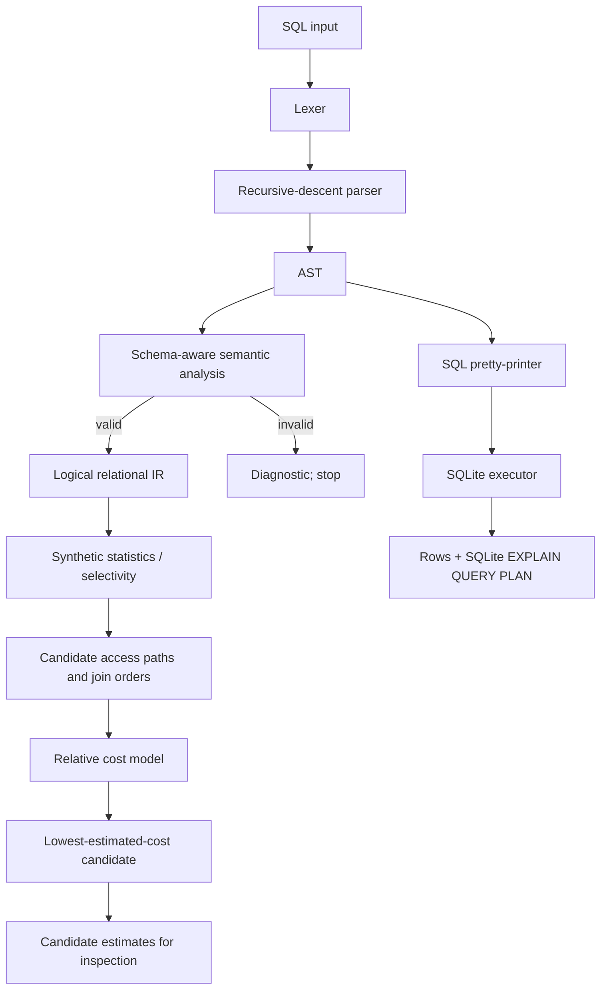

# COSTRA Architecture

The logical route and executable route share the validated AST, but the optimizer's chosen physical-plan estimate is **not** an input to SQLite. SQLite parses and plans the normalized SQL independently. This separation is intentional and must be explained during demonstration.

## Module responsibilities

- Lexical and syntax stages convert text to structured query data.
- Semantic analysis rejects references and aggregate usage that violate the supported schema/rules.
- The logical IR represents operations such as scan, join, filter, aggregate, having, distinct, sort, limit and projection.
- The cost model estimates alternative access paths and join orders using synthetic statistics.
- The executor uses SQLite for reproducible output and displays SQLite's own plan separately.
