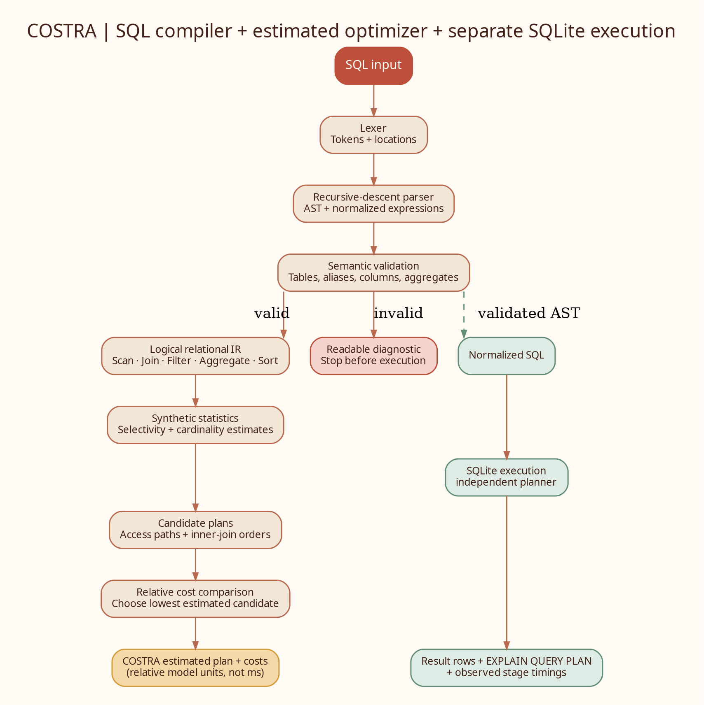

# COSTRA - Cost-Based SQL Compiler & Query Optimizer

**Compiler Design Laboratory - Final Implementation and Testing Report**  
**Student:** Arsh Shukla  
**Registration No.:** 24BDS0113  
**Institution:** VIT Vellore  
**Project type:** Individual project  
**Implementation language:** Python  
**Execution backend:** SQLite

---

## Abstract

COSTRA is an educational SQL compiler and query-optimization prototype. It accepts a supported subset of SQL `SELECT` statements and displays the main language-processing stages: lexical analysis, recursive-descent parsing, abstract syntax tree construction, schema-aware semantic checks, logical relational representation, heuristic cardinality estimation, candidate join-order generation and relative cost-based plan selection. Validated SQL is normalized and executed by an in-memory SQLite database so that results can be inspected during a demonstration.

The implementation deliberately separates COSTRA's estimated physical plan from SQLite's own execution plan. COSTRA uses synthetic row counts, distinct counts, ranges and modelled indexes to compare alternatives. SQLite then independently plans and executes the normalized SQL. This makes the project useful for explaining compiler stages and query-optimization reasoning without claiming to replace a production database optimizer.

The final code includes a command-line demo, a deterministic fixture database, a regression test suite and a repeatable benchmark script. At the report build, 52 automated tests pass. Four representative queries were benchmarked over 30 measured runs each after three warm-up runs; results were repeatable in the local development environment. The numbers are recorded as local evidence rather than general performance guarantees.

## Chapter 1 - Introduction

A database query is written declaratively: the query states what result is required, not every low-level step that must be executed to obtain it. A database engine must parse the query, validate table and column references, construct a logical representation and choose an execution strategy. Join order and access paths matter because the amount of intermediate data can change substantially depending on those choices.

COSTRA brings these ideas into a small Compiler Design project. The SQL statement acts as the source language. The lexer produces tokens, the parser builds an AST, semantic analysis checks references against a known schema, and a relational intermediate representation records operators such as scans, joins, filters, aggregation and sorting. A simplified cost model then compares candidate plans. Finally, SQLite executes the normalized SQL so that the user can compare estimated planning output with real returned rows and SQLite's separately selected query plan.

The scope is intentionally limited. The program is a teaching prototype for the documented query subset, not a complete SQL parser or a production query optimizer.

## Chapter 2 - Problem Statement and Motivation

### Problem statement

A SQL query can have multiple plausible execution strategies. Without a visible representation, the stages between the original query text and the final rows are difficult for a student to inspect. COSTRA addresses this learning problem by making tokenization, parsing, semantic checks, relational operators and relative plan costs visible in one run.

### Motivation

The project connects multiple topics taught in Compiler Design and database systems: lexical rules, grammar and precedence, ASTs, semantic validation, intermediate representations, cardinality, access paths, join algorithms and the separation between logical and physical plans. The command-line workflow keeps the example small enough to explain during a live review.

### Objectives

1. Implement a tokenizer with useful source locations and lexical errors.
2. Parse a practical subset of SQL `SELECT` into an AST.
3. Detect common semantic errors using a schema and table aliases.
4. Build a readable logical relational plan.
5. Estimate cardinalities and relative costs using synthetic statistics.
6. Compare candidate join orders and join methods, then select the lowest estimated cost among those generated.
7. Execute valid examples with SQLite and display output, SQLite's own plan and observed stage timings.
8. Deliver repeatable tests, a benchmark tool, documentation and clear usage instructions.

## Chapter 3 - Background Study

### Lexical and syntax analysis

Lexical analysis groups source characters into tokens such as keywords, identifiers, numeric literals, strings, operators and punctuation. Syntax analysis checks whether the token stream follows a grammar. COSTRA uses a recursive-descent parser with layered expression functions to implement precedence: logical `OR`, logical `AND`, `NOT`, comparisons, additive operations, multiplicative operations, unary operators and primary expressions.

### AST and semantic validation

An abstract syntax tree represents the meaning-bearing structure of a query rather than retaining only the original text. Semantic analysis checks whether tables exist in the configured schema, whether aliases resolve, whether referenced columns exist, whether unqualified columns are ambiguous, and whether aggregates are used in supported clauses and grouping combinations.

### Relational representation

The relational intermediate representation uses nodes for table scans, joins, filters, aggregation, `HAVING`, `DISTINCT`, sorting, limiting and projection. Separating this representation from the textual SQL allows the project to show how a query's logical operations are arranged before discussing physical methods.

### Query optimization

A cost-based optimizer estimates the work associated with candidate strategies and chooses the lowest estimated cost from the candidates it generated. Real database systems use sophisticated statistics, constraints, histograms, search strategies and calibrated cost models. COSTRA intentionally uses synthetic statistics and a compact heuristic cost model so the calculations stay inspectable.

## Chapter 4 - Scope and Requirements

### Supported scope

The parser supports projection expressions, aliases, `*`, qualified `table.*`, `DISTINCT`, table aliases, inner/left/right/cross joins, `WHERE`, `GROUP BY`, `HAVING`, `ORDER BY`, integer `LIMIT`, five aggregate functions, arithmetic, comparisons, Boolean operators, `IS [NOT] NULL`, `[NOT] IN`, `[NOT] BETWEEN`, `[NOT] LIKE`, numeric/string/NULL/Boolean literals and line comments.

### Out of scope

Subqueries, common table expressions, window functions, `UNION`, `CASE`, quoted identifiers, full SQL type inference, multi-statement scripts and complete SQL-standard compliance are not implemented. The README lists the same boundary for users.

### Functional requirements

- Process one supported `SELECT` statement.
- Report lexical, syntax and semantic errors without proceeding to execution when a prior stage fails.
- Represent the parsed query in an AST and logical IR.
- Estimate rows/costs and retain a small set of candidate plans.
- Execute valid normalized SQL and show its output.
- Make the estimated COSTRA plan and SQLite's actual plan visibly distinct.
- Provide tests and instructions that run without third-party Python packages.

## Chapter 5 - System Design

### Pipeline



*Figure 1. The analytical optimizer branch and SQLite execution branch are kept separate.*

The two branches meet only through the query representation: COSTRA displays its own estimated plan, while SQLite independently plans and executes the normalized SQL. No code passes COSTRA's chosen join order or physical operator tree into SQLite's internal query planner.

### Module map

| Module | Role in the design |
|---|---|
| `lexer.py` | Token recognition, keyword normalization and location-aware lexical diagnostics |
| `parser.py` | Recursive-descent grammar and expression precedence |
| `ast_nodes.py` | AST data structures and normalized SQL formatting |
| `semantic.py` | Schema, alias, column, aggregate and grouping checks |
| `schema.py` | Schema declarations, synthetic planning statistics and modelled indexes |
| `statistics.py` | Predicate selectivity and referenced-column helpers |
| `ir.py` | Logical relational plan node construction and tree output |
| `optimizer.py` | Scan/access-path estimates, join-order enumeration, join costing, aggregate/sort costs and selection |
| `compiler.py` | Orchestrates compile and optimize stages, capturing errors/timings |
| `executor.py` | Seeds the in-memory SQLite fixture, executes normalized SQL and exposes SQLite's own plan |
| `main.py` | Interactive end-to-end demonstration and readable console output |
| `test_costra.py` | Unit and integration regression tests |
| `benchmark.py` | Repeatable local end-to-end timing with JSON/CSV results |

## Chapter 6 - Compiler Design Concepts Used

### Lexical analysis

The tokenizer distinguishes keywords, identifiers, numbers, strings, operators, punctuation and comments. It records line and column locations, so invalid characters can be reported without displaying an unhelpful traceback.

### Syntax analysis and AST

The recursive-descent parser separates expression precedence into functions. Parentheses override normal precedence. The AST uses dataclasses such as `SelectQuery`, `SelectItem`, `TableRef`, `JoinClause`, `ColumnRef`, `Literal`, `BinaryExpr`, `FunctionCall` and predicate nodes for `IN`, `BETWEEN` and `IS NULL`.

### Semantic analysis and symbol/alias resolution

The analyzer maps each table reference or alias to a canonical schema table. It checks unknown or duplicated aliases, invalid table references, missing columns, ambiguous unqualified columns and unsupported function/aggregate use. Basic grouping checks prevent common invalid selections that mix aggregate and ungrouped columns.

### Intermediate representation

The logical plan is represented as a tree of relational operators. This is an intermediate representation because it is a structured query plan rather than the original string or an executed result.

### Optimization

The optimizer computes simple selectivity estimates for common predicates, uses modelled index availability to compare access-path costs, and enumerates candidate relation orders for eligible inner joins. At each join step it compares nested-loop, hash-join and merge-join estimates. If an outer or cross join is present, it preserves the written join order rather than freely commuting the relation order.

## Chapter 7 - Implementation Details

### Statistics and access-path estimates

The `STATS` dictionary includes synthetic row counts, distinct counts and numeric ranges. `INDEXES` lists indexes assumed by the model. These values are used only for the optimizer's educational estimate. They are neither queried from SQLite nor continuously updated from data.

For a table with a simple searchable predicate on a modelled indexed column, the estimate compares a full scan with an index-path estimate. The lower-cost access path is shown in the selected estimated plan. This is a model choice, not a command to create or use that index in SQLite.

### Join-order and join-method comparison

COSTRA generates inner-join relation permutations up to a safety cap, attaches join predicates when their referenced relations are available, estimates output cardinalities, and chooses a join algorithm for each join step according to the relative cost formulas. It retains up to six low-cost join-order candidates. This is capped permutation enumeration with a greedy per-step algorithm choice; it is not a dynamic-programming optimizer.

### Execution

The executor creates a fresh in-memory SQLite database with four tables: `Employee`, `Department`, `Project` and `Assignment`. The fixture is deliberately small and deterministic. After successful lexical, syntax and semantic checks, the AST is formatted as one SQL `SELECT` and passed to SQLite. The program displays returned headers/rows and calls `EXPLAIN QUERY PLAN` separately.

### Error behavior

The compile pipeline returns a failed stage and diagnostic for lexical, syntax, semantic or optimizer errors. Queries that fail the first three validation stages are not executed. SQLite exceptions are wrapped in a readable `ExecutionError`.

### Professor-selectable review menu

The default `python3 main.py` command opens an eight-option interactive menu. Options 1-3 present Review 1 design, Review 2 core-module walkthrough, and Review 3 end-to-end execution; option 4 accepts one user-entered `SELECT`; option 5 prints a worked access-path calculation and compares the six multi-join candidates; option 6 summarizes the review milestones; option 7 demonstrates semantic rejection; and option 8 exits. Each option returns to the menu so the presenter can choose the next demonstration in response to a question. The menu is switch-style dispatch implemented with a dictionary so it remains compatible with Python 3.9+.

## Chapter 8 - Testing and Validation

The project includes 52 regression tests in the current checked-in suite. They cover:

- Token classes, keyword casing, comments, escaped strings, and location-aware lexical errors.
- Clause parsing, precedence, qualified wildcard selection, aggregate syntax, predicate extensions and invalid statement shapes.
- Unknown/duplicate aliases, unknown tables/columns, ambiguous columns, aggregate placement, unsupported functions, type checks and grouping rules.
- Candidate generation, cost-minimum selection, indexed access-path estimates, scalar aggregation, `DISTINCT` and outer-join order preservation.
- Repeatable demo output, SQLite's actual query plan, string handling, inner/outer/cross join execution, and fail-fast behavior.

### Test result

The regression run recorded in `reports/test_results.txt` is **52 tests passed**. Tests are implemented with the Python standard library and can be repeated with `python3 -m unittest -v`.

## Chapter 9 - Results and Performance Evidence

### Functional demo

The example query joins employee, department, assignment and project data, filters on employee salary and project budget, groups by department, applies an aggregate `HAVING`, sorts by average salary and applies `LIMIT 5`. In the small seeded fixture, it returns the following rows:

| Department | Employee count | Average salary |
|---|---:|---:|
| Finance | 1 | 91000.0 |
| Engineering | 5 | 79600.0 |
| HR | 1 | 69000.0 |

Only three rows meet the query's conditions in the seeded sample. The project does not infer that the synthetic planning statistics should predict the same result count; its planning estimates model a larger hypothetical dataset.

### Local benchmark

Four queries were measured with three warm-up runs and 30 measured repetitions using one reused in-memory SQLite fixture. The end-to-end clock covers COSTRA compile/optimization and the executor call. The values below are local observations from the recorded environment, not service-level guarantees.

| Query | Rows | Candidate plans | Median end-to-end time |
|---|---:|---:|---:|
| Multi-join aggregation demo | 3 | 6 | 1.7283 ms |
| Indexed salary filter | 2 | 1 | 0.1520 ms |
| Grouped department counts | 4 | 2 | 0.2551 ms |
| Distinct departments | 4 | 1 | 0.0837 ms |

Full min/median/mean/p95/max and stage medians are available in `reports/benchmark_results.json`; the summary is in `reports/benchmark_results.csv`. The runtime environment metadata is stored alongside the results.

### Interpretation

The results confirm that the examples execute consistently in this environment and give a repeatable demonstration of the pipeline. They do not prove that COSTRA is faster than SQLite: SQLite still chooses its own execution plan, and the SQL queries run over eight employee fixture rows. The synthetic cost units should not be compared directly to the measured milliseconds.

## Chapter 10 - Limitations and Future Enhancements

### Current limitations

1. The parser implements a SQL subset, not the complete SQL grammar.
2. Statistics and selectivity are synthetic and can differ greatly from sample data.
3. Join-order enumeration uses capped permutations rather than dynamic programming.
4. The optimizer's selected estimated plan is not injected into SQLite's execution engine.
5. The fixture is small and in memory; it does not represent production workloads.
6. Stage timings vary with hardware, Python version and machine load.

### Possible future work

- Replace hard-coded statistics with collected table/column statistics and histograms.
- Use a dynamic-programming join-order search or a memoized search space for larger queries.
- Add stronger expression type checking and broader grouping/aggregate rules.
- Add `CASE`, subqueries, CTEs, `UNION`, and window functions after defining and testing the expanded grammar.
- Add optional AST/IR tree visualization to help explain the intermediate representations.
- If true plan execution is desired, implement a small executor that follows COSTRA's physical operators directly rather than suggesting that SQLite honors its plan.
- Increase dataset scale and conduct controlled repeated performance experiments with documented machine details.

## Chapter 11 - Conclusion

COSTRA demonstrates a coherent SQL-processing pipeline suitable for explaining Compiler Design concepts in an executable form. It turns SQL text into tokens, an AST, semantic diagnostics and relational IR; it then uses synthetic statistics to compare access paths and inner-join orders before displaying the cheapest estimated candidate. Valid queries are executed by SQLite and accompanied by SQLite's own plan and timing evidence.

The final implementation adds broader predicate parsing, stronger semantic checks, fail-fast diagnostics, outer-join order protection, candidate-plan detail, automated regression coverage, a repeatable benchmark and final-review documentation. Its strongest result is not a claim to replace a commercial optimizer; it is a transparent, testable learning tool with a clearly stated execution boundary.

## References

1. A. V. Aho, M. S. Lam, R. Sethi and J. D. Ullman, *Compilers: Principles, Techniques, and Tools*, 2nd ed., Pearson, 2006.
2. SQLite documentation, “EXPLAIN QUERY PLAN.” https://sqlite.org/eqp.html
3. SQLite documentation, “SELECT.” https://sqlite.org/lang_select.html
4. Python documentation, `sqlite3` — DB-API 2.0 interface for SQLite databases. https://docs.python.org/3/library/sqlite3.html
5. COSTRA source modules, tests and benchmark artifacts in this repository.

## Appendix A - Run commands

```bash
python3 main.py --demo
python3 main.py --error-demo
python3 -m unittest -v
python3 benchmark.py
```

## Appendix B - Demonstration checklist

1. Show the repository files and run `python3 main.py`.
2. Run the complete multi-join demo.
3. Explain tokenization, AST construction and semantic validation.
4. Point to the logical relational plan.
5. Compare the candidate costs and explain the selected estimate.
6. Show the result rows and SQLite's independent `EXPLAIN QUERY PLAN` output.
7. Run the unknown-column example to demonstrate semantic error handling.
8. Mention the key boundary: COSTRA estimates plans; SQLite independently executes the normalized SQL.
